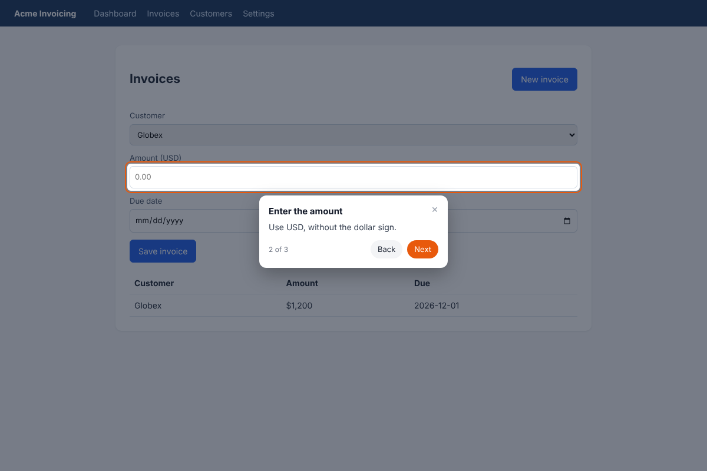
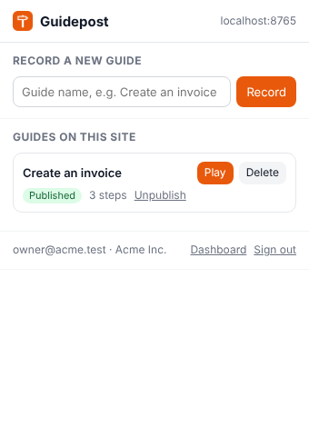
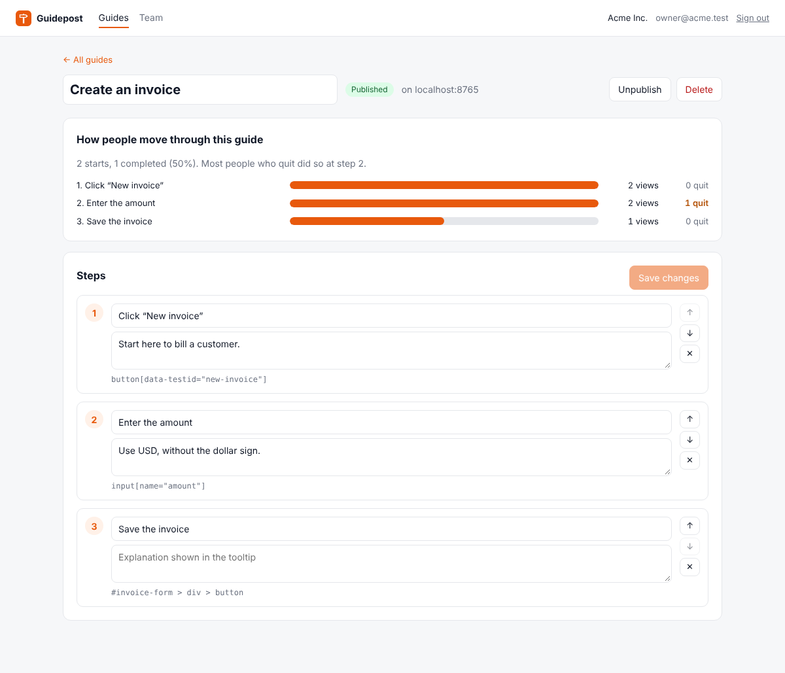

# Guidepost

An original digital adoption platform, sold as SaaS: authors record in-app walkthroughs on any web app with a Chrome extension, and the people in their workspace play them back as guided tooltips. A dashboard shows where people finish or drop off.

"Guidepost" is a working name.

| Part | Path | Stack |
| --- | --- | --- |
| Browser extension (recorder + player) | `apps/extension` | TypeScript, Chrome Manifest V3, esbuild |
| API | `apps/api` | TypeScript, Fastify, Postgres (or embedded PGlite for development) |
| Admin dashboard | `apps/dashboard` | TypeScript, React, Vite |
| Shared types | `packages/shared` | TypeScript |

| Player in the target app | Extension popup | Guide analytics |
| --- | --- | --- |
|  |  |  |

## How it works

1. An **owner** creates a workspace in the dashboard and adds people as **editors** (write guides, see analytics) or **viewers** (end users who play guides).
2. An editor signs in to the extension, opens the target web app, names a guide and presses **Record**. Each click opens a small editor for the step's title and explanation instead of triggering the app; **Save & click** saves the step and performs the click so the author can keep going. Recording survives page navigation.
3. **Finish** saves the guide to the API as a draft. Publishing it (in the popup or dashboard) makes it visible to viewers on that site.
4. Viewers press **Play** in the extension. The page dims, the element is highlighted, and a tooltip walks them through each step, across pages too. Clicking the highlighted element moves on.
5. Starts, step views, completions and exits are sent to the API, and the dashboard shows completion rates and the step where people quit.

Only the extension's background worker talks to the API; the page you're guiding never sees the token. All extension UI is drawn inside a Shadow DOM so the host app's styles can't break it.

## Run it locally

Requires Node 20+.

```bash
npm install
npm run dev:api          # API on http://localhost:4000 (embedded database in apps/api/.pglite)
npm run dev:dashboard    # dashboard on http://localhost:5173
npm run build -w @guidepost/extension
```

Then in Chrome open `chrome://extensions`, turn on **Developer mode**, click **Load unpacked** and pick `apps/extension/dist`. Create a workspace at http://localhost:5173/#/signup and sign in to the extension with the same account. A demo app to try it on is in `e2e/demo/index.html`.

To use a real Postgres instead of the embedded database: `docker compose up -d`, then copy `apps/api/.env.example` to `apps/api/.env`.

## Tests

```bash
npm run typecheck
npm test             # API tests on an in-memory database
TEST_DATABASE_URL=postgres://… npm test -w @guidepost/api   # same tests on real Postgres
npm run build && npm run test:e2e   # full flow in Chromium: sign up, record, publish, play, analytics
```

The end-to-end test saves screenshots to `e2e/screenshots/`.

## API

All routes except `/auth/*` and `/health` need `Authorization: Bearer <token>`.

| Method | Path | Who | What |
| --- | --- | --- | --- |
| POST | `/auth/signup` | anyone | Create a workspace and its owner |
| POST | `/auth/login` | anyone | Get a token |
| GET | `/me` | member | Current user and workspace |
| GET / POST | `/members` | owner (GET: editors too) | List or add people |
| PATCH / DELETE | `/members/:id` | owner | Change role, remove |
| GET | `/flows?host=` | member | Guides (viewers see published ones only) |
| POST | `/flows` | editor | Create a guide |
| GET / PATCH / DELETE | `/flows/:id` | editor (GET: viewers for published) | Read, edit, publish, delete |
| POST | `/events` | member | Record up to 200 analytics events |
| GET | `/analytics` | editor | Starts, completions, views and exits per step |

## Roadmap

- **Now (MVP):** workspaces and roles, recorder, player, publish, analytics.
- **Next (pilot):** auto-start rules (first visit, URL match), invite links and password reset, flow versioning, iframe support, Chrome Web Store listing, hosted deployment.
- **Later:** onboarding checklists, smart tips, announcements, a resource center, billing.
